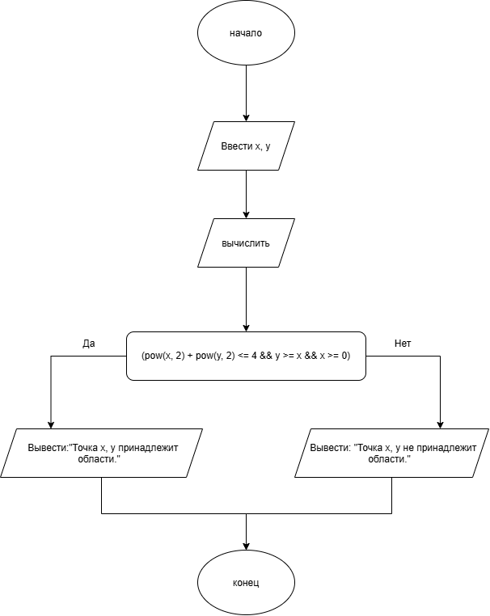

# Домашнее задание к работе 6

## Условие задачи

Составить программу, которая проверяет принадлежит ли заданная пользователем точка с координатами (x, y) заданным закрашенным (заштрихованным) областям, показанным на рисунках в табл., и выводит на экран сообщение.
---

## 1. Алгоритм и блок-схема

### Алгоритм

1. Объявить переменную `x`, `y`типа `float`.
2. Запросить у пользователя две координаты (`x`, `y`).
3. Рассчитать попадает ли точка с заданными координатами в условие `(pow(x, 2) + pow(y, 2) <= 4 && y >= x && x >= 0)`.
4. Вывести ответ принадлежит ли точка области.
5. Завершить программу.

## Блок-схема

---

## 2. Реализация программы
---

## 3. Результаты работы программы

Пример работы программы при вводе  x = **1**, y = ** 1.5**  :

---

Введите значение x:1
Введите значение y:1.5
Точка 1.000000, 1.500000 принадлежит области.

---

## 4. Информация о разработчике

- **ФИО:** Губский Данил Максимович
- **Группа:** бОТИ-261
